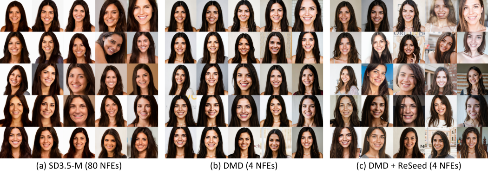

# ReSeed

**Restoring same-prompt diversity in few-step distilled diffusion models with a
first-step tiny bias adapter — no student retraining.**

<p align="center">
  
</p>

<p align="center"><em>Same prompt, same 25 initial noises. The 4-step DMD student (b) collapses to
near-identical faces; ReSeed (c) restores the teacher's variety (a) — at 4 NFEs,
without touching the student's weights.</em></p>

A four-step DMD/DMD2/SenseFlow student produces sharp images and videos but
collapses the variety a prompt should span across different initial noises.
ReSeed diagnoses that the collapse is decided almost entirely in the **first**
denoising step, and repairs it by adding a constant, zero-initialised
per-channel bias to each transformer block's output, **active only during the
first step**. The bias is fitted so the student's first-step velocity matches
the frozen teacher's velocity across the same interval. Every base weight stays
frozen; steps 2–N run the unmodified student; inference cost is essentially
unchanged (≤ 456 KiB of parameters, +0.14 % latency on video, no extra activation
memory).

The same collapse-and-recovery holds on **SenseFlow-FLUX** — the prompt "a cat
resting on an open laptop computer" at nine matched seeds, as three 3×3 blocks
(teacher / four-step student / student + ReSeed):

<p align="center">
  
</p>
<p align="center"><em>SenseFlow-FLUX, matched seeds. Left: teacher. Middle: the four-step student
collapses to one near-identical pose. Right: ReSeed restores the spread.</em></p>

…and on **Wan2.1-T2V-1.3B** video. Each grid shares one prompt across a row of
seeds, with **top row = teacher, middle row = four-step DMD2 student,
bottom row = DMD2 + ReSeed**. The DMD2 row collapses to near-identical clips;
ReSeed restores the teacher's per-seed variety.

<p align="center">
  
</p>
<p align="center"><em>Prompt: pouring latte art. Top row: teacher · middle row: four-step DMD2 student · bottom row: DMD2 + ReSeed.</em></p>

<p align="center">
  
</p>
<p align="center"><em>Prompt: a child with a sparkler at night. Top row: teacher · middle row: four-step DMD2 student · bottom row: DMD2 + ReSeed.</em></p>

## What is in this repository

The method is one idea applied to four released students. The code is split by
runtime, because the image and video students live in different frameworks.

```
ReSeed/
├── image/                    self-contained `reseed` package (SD3-M, SD3.5-M, SenseFlow-FLUX)
│   ├── src/reseed/           adapters, trainers, flow solver, evaluation, CLI
│   ├── tools/                generation + diversity/quality scorers
│   ├── configs/              evaluation protocols (sha-pinned) and prompt banks
│   ├── pyproject.toml        installs the `reseed` package + `reseed` CLI
│   └── requirements.txt
└── video/                    ReSeed for Wan2.1-T2V-1.3B, as a plug-in for the
                              Data-Forcing-Distillation (DFD) / fastgen stack
    ├── evaluation/reseed/    adapter, flow, trainer, encode/eval helpers
    ├── evaluation/metrics/   DINOv2/CLIP video diversity math
    ├── evaluation/tools/     config + probes
    └── patches/              the one-file change to the DFD inference entrypoint
```

| model | backbone | ReSeed lives in | students come from |
|---|---|---|---|
| SD3-Medium | MMDiT rectified flow | `image/` | released 4-step DMD student |
| SD3.5-Medium | MMDiT-X rectified flow | `image/` | released 4-step DMD student |
| SenseFlow-FLUX | FLUX.1-dev rectified flow | `image/` | SenseFlow 4-step student |
| Wan2.1-T2V-1.3B | video DiT | `video/` | released DFD DMD2 4-step student |

**Scope.** This repository contains the ReSeed adapter — its training,
evaluation, and inference — for the four models reported in the paper. It does
**not** distil the few-step students themselves; those are released/upstream
checkpoints that ReSeed treats as frozen inputs (see each model's row above).
It also does not include the exploratory backbones (SDXL, PixArt) or the
distillation baselines (GAD, DP-DMD, LoRA) that lived alongside ReSeed during
research.

## Quickstart

Image side (installs the `reseed` package and CLI):

```bash
cd image
pip install -e .            # add ".[eval]" for the scoring stack
python -m reseed --help
```

Then, with a frozen teacher and a released student checkpoint on disk:

```bash
# 1. fit the first-step bias adapter (single GPU shown; use torchrun for multi-GPU)
python -m reseed train sd3m \
    --model   $TEACHER \
    --student-checkpoint $STUDENT \
    --prompt-file prompts.txt \
    --output  runs/sd3m_seed42 --max-steps 2000

# 2. generate with the adapter switched on for step 1 only
python -m reseed generate sd35m --mode sd35m-dmd \
    --model $MODEL --checkpoint $STUDENT \
    --first-interval-residual-bias-checkpoint runs/sd35m_seed42/checkpoint-2100 \
    --prompts configs/protocols/... --output out/ --inference-steps 4

# 3. score diversity (DINOv3 / CLIP / LPIPS) and quality (HPSv2.1 / LAION-AeS / FID)
python -m reseed diversity feature score --manifest out/generation_manifest.jsonl --output div/
python -m reseed score quality suite     --manifest out/generation_manifest.jsonl --output q/
```

Full per-model recipes are in [`image/README.md`](image/README.md).

Video side (a plug-in dropped into a DFD/fastgen checkout):
see [`video/README.md`](video/README.md).

## Reproducibility notes

- Evaluation protocols under `image/configs/protocols/` are pinned by SHA-256
  (name, model contract, prompt-CSV hash). The generators refuse to run against
  a mismatched protocol or a student whose declared inference-step count does
  not match. The large COCO-2017 caption CSVs the protocols reference are not
  vendored; regenerate them from COCO-2017-val (see
  [`image/configs/README.md`](image/configs/README.md)).
- All comparisons within a table share prompts, initial noises, and scorers.
  Forward passes are bfloat16; offline analysis is float64.

## Provenance and license

Released under the MIT License (see [`LICENSE`](LICENSE)). One evaluation script
(`image/tools/score_clip_pickscore.py`) is vendored from the MIT-licensed GAD
project; the video side plugs into (and does not vendor) the Data-Forcing
Distillation / fastgen stack. See [`NOTICE.md`](NOTICE.md) for full provenance
and upstream citations.
